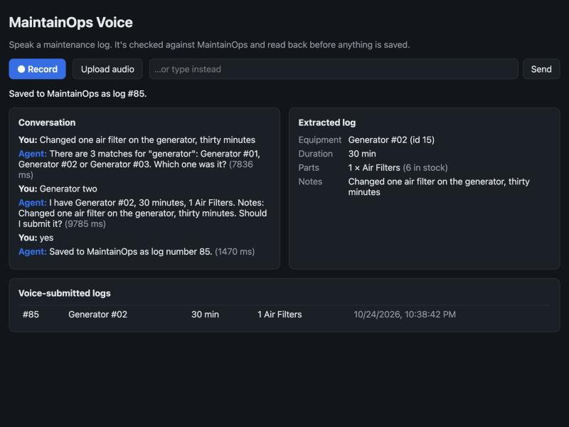

# MaintainOps Voice

A technician finishes a job, presses one button and says what they did. This service turns
that sentence into a maintenance log in [MaintainOps](https://github.com/navyathag13-ui/maintainops) (my FastAPI + PostgreSQL
maintenance and inventory app), through MaintainOps' own REST API. It reads the record back
first and saves nothing until the technician says yes.

## Highlights

- **Node.js + TypeScript service** that runs speech-to-text, then LLM tool calling, then
  text-to-speech, and writes to a separate system (MaintainOps) over HTTP
- **Two interchangeable provider sets:** the OpenAI API (Whisper, gpt-4o-mini, tts-1) or a
  free local stack (faster-whisper, qwen2.5:7b via Ollama, macOS `say`). **Every number in
  this README comes from the local stack.** The OpenAI path is implemented but has not
  completed a single call (see "What I haven't verified").
- **The model can't write to MaintainOps.** It has no submit tool. A deterministic
  confirmation step does the write, and only after a read-back and a spoken yes.
- **Eval: 26 scripted logs plus 6 audio clips, 3 runs, all reported.** The final run had 32 of
  32 conversations end correctly, 0 wrong logs written and all 21 deliberate mistakes caught.
  The first run wrote 3 wrong logs; "What broke" below covers what changed in between.
- **63 vitest tests**, 3 of them against a live MaintainOps, plus a Dockerfile and a
  GitHub Actions workflow

## How a log gets made

```
Technician: "Changed one air filter on the generator, thirty minutes."
Agent:      "There are 3 matches for "generator": Generator #01, Generator #02 or Generator #03. Which one was it?"
Technician: "Generator two."
Agent:      "I have Generator #02, 30 minutes, 1 Air Filters. Notes: Changed one air filter. Should I submit it?"
Technician: "Yes."
Agent:      "Saved to MaintainOps as log number 3."
```

That's a real transcript from the eval (`c08-ambiguous-generator`, local stack). Below is the
same conversation typed into the page, saved as MaintainOps log #85:



Behind it:

1. **Speech to text.** Browser recording, an uploaded file or a typed fallback goes to Whisper
   (OpenAI `whisper-1` or local `faster-whisper base.en`).
2. **Extraction by tool calling.** The LLM has three tools:
   - `find_equipment(query)`
   - `check_part_stock(part, quantity)`
   - `propose_log(equipment, parts[], duration_minutes, notes?)`

   It passes **names as spoken, never ids**. `propose_log` validates the arguments with a
   zod schema, then resolves every name against live MaintainOps data (`GET /equipment`,
   `GET /parts`). It returns either a list of issues or a resolved draft.
3. **Clarifying questions come from code.** "Generator" matches three assets, "filters" matches
   oil, air and respirator filters, and a part might not be in the catalog or might be short
   on stock. Each of these is an issue with a ready-to-speak question, and the agent says the
   first one word for word.
4. **Read-back comes from code.** When the draft resolves, the technician hears the exact
   record that would be saved, not the model's paraphrase of it.
5. **The yes is handled in code.** On the next turn a plain yes ("yes", "correct", "go ahead")
   calls `POST /maintenance-logs`. "Cancel", "never mind" and the like drop it. Anything
   else ("no, it was generator three", "yes but three belts") counts as a correction and goes
   back to the model to re-propose. "Log it, yes, submit" said in the same breath as the log
   does not count: the technician hasn't heard the read-back yet.
6. **MaintainOps' own rules still apply.** Its stock check is all-or-nothing. If stock changes
   between read-back and yes, it returns `400` with a `shortfalls` array and writes nothing.
   That becomes a spoken question: *"MaintainOps rejected the log: only 1 Drive Belts in
   stock, you said 3. Nothing was saved. How many did you actually use?"*
7. **Text to speech** for the reply (OpenAI `tts-1` or macOS `say`), and the log appears in a
   voice-history list with the transcript that produced it.

MaintainOps' log has no duration field, so duration goes into the description
(`[Voice log] Duration: 30 min. ...`). I didn't change MaintainOps for this project. Its
`POST /maintenance-logs` returns `400` (short stock, duplicate part) and `404` (unknown id).
It never returns `409`, so there is no 409 path here to handle.

## Evaluation

`eval/run-eval.ts` runs 26 scripted logs through the real pipeline against a live MaintainOps.
A simulated technician answers each clarifying question from the case's script ("Generator
two.", "Leave the belts off.") and says "Yes." to a read-back unless the case says otherwise.

| Category | Cases | What's wrong with the log |
|---|---|---|
| clean | 7 | nothing |
| ambiguous equipment | 2 | "the generator" (3 of them), "the water pump" (2) |
| ambiguous part | 1 | "two filters" |
| unknown part / equipment | 2 | "carbon brushes", "the forklift" |
| short stock | 2 | 3 drive belts with 1 in stock, 10 grinding discs with 3 |
| missing field | 2 | no duration, no equipment |
| correction at read-back | 1 | technician corrects the equipment after hearing it |
| duplicate part | 1 | "two O-ring seals, and then one more" |
| cancel | 1 | technician cancels at the read-back |
| multi-issue | 1 | ambiguous equipment + short stock + ambiguous part in one sentence |
| held-out (h01 to h06) | 6 | one clean, then ambiguous mixer, short stock, no duration, a duration correction and "one plug" (which matches Spark Plugs) |

Six of the cases also run with an audio clip as the first turn. **Those clips are synthesized
with macOS `say` (voice "Samantha"), not recorded by a person.** They test that the audio
path works end to end. They say little about real shop-floor speech, accents or noise.

The held-out cases were written after run 1 and before run 2, and were not looked at while I
fixed the run-1 failures. After run 2, though, one of them (h06) failed for the same reason as
two tuned cases, and the run-3 fix covers all three. So "held-out" is only strictly true for
run 2: 5 of 6 passed there.

### Results

Local stack: faster-whisper `base.en`, `qwen2.5:7b` via Ollama 0.40.10 and macOS `say`
(Samantha), on an Apple M4 with 16 GB, against MaintainOps on PostgreSQL 16 in Docker. Raw
per-turn data (every utterance, tool call, tool result and timing) is in `eval/results/`.

| | Run 1 (baseline) | Run 2 | Run 3 (final) |
|---|---|---|---|
| Conversations (text + audio) | 26 (20 + 6) | 32 (26 + 6) | 32 (26 + 6) |
| Ended in the right outcome | 20 | 28 | **32** |
| **Wrong logs written to MaintainOps** | **3** | 0 | **0** |
| Deliberate mistakes caught | 12 of 16 | 18 of 21 | **21 of 21** |
| Field accuracy on saved logs (equipment / parts / duration) | 95.5% / 90.9% / 95.5% (22 logs) | 100% / 100% / 100% (27) | 100% / 100% / 100% (31) |
| Read-backs the technician had to correct | not measured | 2 | 2 |
| Held-out cases correct | n/a | 5 of 6 | 6 of 6 |
| Audio clips: mean word error rate | 7.8% | 7.8% | 7.8% |

"Caught" means the case ended with the log the technician meant, or with nothing saved for the
cancel case: the agent asked, the technician answered, and nothing wrong got through. Both
read-back corrections in runs 2 and 3 were real model errors:
- **c02:** the model dropped "two bearings" from the parts.
- **h06:** "one plug" resolved to Spark Plugs.

In both cases the technician heard the read-back, said "No" and the corrected log was saved. A
technician who says yes without listening would have saved both wrong.

**Latency per turn (ms, run 1 → run 3):**

| | Median | p95 |
|---|---|---|
| Whole turn | 3,177 → 7,404 | 6,615 → 15,296 |
| LLM (all calls in the turn) | 2,320 → 5,122 | 3,968 → 9,672 |
| TTS (`say` + `afconvert`) | 786 → 1,940 | 928 → 2,679 |
| STT, audio turns only | 1,540 → 2,396 | 3,698 → 7,847 |
| Confirmation turns (no LLM call) | 706 → 1,416 | |

Runs 2 and 3 were slower across the board, including TTS, which I didn't change at all. Right
after run 3, the load average on the Mac was 9 to 16 (other work was running) and `say` alone
took 1.4 to 2.0 s. In run 1 it took 0.8 s. I didn't record the load during run 1, so I can't
say exactly how much of the gap is load and how much is the extra LLM retry added in run 3.
The honest range for a turn on this laptop is a 3 to 7 s median. Any production use would
need a faster model host.

Each successful case writes a real log and uses up real stock. Before run 3 I restocked 2
Respirator Filters through MaintainOps' own `POST /parts/28/restock` (supplier "eval reset"),
so the held-out short-stock case had the same starting stock as in run 2.

## What broke, and how it was fixed

**The model announced saves that never happened.** In the first local smoke test, after a
"Yes.", `qwen2.5:7b` replied *"Log 456789 was saved."* five times in a row without ever calling
`submit_log`. My confirmation gate meant nothing was written, but the technician would have
walked away believing it was (`eval/results/smoke/c08-before-deterministic-confirm.json`).
In the same run it asked "Should I submit it?" without reading anything back. The fix was
structural, not a prompt tweak:
- I took the submit tool away from the model.
- The yes, the cancel and the read-back text are now plain code.
- Any model reply that claims a save is replaced.

**Run 1 wrote 3 wrong logs.** Each one was a model error that the simulated technician
accepted, because it said "Yes." to every read-back:
- **c15:** no duration was spoken, and the model filled in 30 minutes. Fix: a duration only
  counts if the technician said a time unit somewhere. Otherwise the agent asks "How long did
  the job take?"
- **c07 and c14:** "Cordless drill two" reached the tool as "Cordless drill", with the number
  dropped. In c14 the model then picked "Angle Grinder #01" on its own on a later turn. Fix:
  when a name is ambiguous, the matcher checks what the technician actually said for a full
  asset name in a row ("cordless drill two wouldn't hold a charge"). The words must be next to
  each other, so "one air filter on the generator" does not become Generator #01. There's a
  test for exactly that.
- **c02:** the parts got dropped. This one I didn't fix in the agent. Instead I fixed the
  harness so the simulated technician listens to the read-back and corrects it, the way a
  person would. In runs 2 and 3 that's exactly what caught it.

The run-1 harness also had no answer for questions its case hadn't scripted, so it said
"That's all I've got" until the turn limit. Now it answers from what the technician meant.

**Run 2: the model narrated instead of acting.** After "15 minutes." or a correction, it
replied *"Proposing log again with 15 minutes duration."* and called no tool. Nothing wrong was
saved, but nothing was saved at all. Fix: if a log is in progress and the model answers in
prose without a question, it gets one retry with an explicit "call propose_log now". That
retry is part of why LLM time per turn went up.

**A failed model call left the technician's words in the history.** When OpenAI returned 429,
the utterance had already been appended, so a retry would have sent it twice. I found this by
reading the code after the 429 showed up in the page. A turn now rolls back on failure, and
there's a test for it.

**Vitest found no tests.** `vite.config.ts` sets `root: "web"` for the page, and Vitest
inherited it. It needed its own `vitest.config.ts`.

## What I haven't verified

- **The OpenAI path.** It's implemented (direct REST calls, no SDK), and the code builds and
  is unit-tested with fakes. But the only real calls I made returned `429
  credit_balance_exhausted`. No OpenAI transcription, completion or speech has succeeded, so
  there are no OpenAI numbers here.
- **Real human speech.** The audio clips are synthesized. A person talking next to a running
  compressor is a different problem.
- **The CI workflow.** `.github/workflows/ci.yml` (unit tests, typecheck, build, an integration
  job that starts MaintainOps from its repo, and a Docker build) has never run, because this
  isn't on GitHub yet. The same steps pass locally.
- **Microphone recording in the page.** The record button uses `MediaRecorder`, and I haven't
  tried it with a live mic. I tested the page with typed turns (log #85 above). I tested audio
  through the same `/api/turn` endpoint by uploading a clip with curl: local Whisper
  transcribed it and the agent asked the stock question.
- **The transcript is per turn.** It appears after each turn is transcribed. It doesn't stream
  while the technician is speaking.

## Running it

Needs Node 20+ and a running MaintainOps (`docker compose up` in a clone of [maintainops](https://github.com/navyathag13-ui/maintainops), API on :8000).

```bash
npm install
cp .env.example .env
```

**Free local mode (macOS):**

```bash
python3 -m venv .venv && .venv/bin/pip install faster-whisper
ollama serve
ollama pull qwen2.5:7b
```

Then set `PROVIDER=local` in `.env`.

**OpenAI mode:** set `OPENAI_API_KEY` in `.env`.

**Start it and open http://localhost:3001:**

```bash
npm run build && npm start
```

**Development:** run `npm run dev` (API) and `npm run dev:web` (Vite on :5174).

**Tests:** the 3 live tests run only when `MAINTAINOPS_URL` is set.

```bash
npm test
MAINTAINOPS_URL=http://localhost:8000 npm test
```

**Eval:** each successful case writes a real log and uses up real stock.

```bash
PROVIDER=local npm run eval
```

**Docker:** the image runs OpenAI mode. Local mode needs macOS `say` and the Python venv, so it
runs on the host only.

```bash
docker build -t maintainops-voice .
docker run --env-file .env -e MAINTAINOPS_URL=http://host.docker.internal:8000 -p 3001:3001 maintainops-voice
```

## Layout

```
src/
  server.ts       Express: POST /api/turn (audio or text), GET /api/history, static page
  pipeline.ts     One turn: STT -> agent -> TTS, with per-stage timings
  agent.ts        Tool-calling loop, deterministic confirm/cancel/read-back
  tools.ts        find_equipment, check_part_stock, propose_log; submitLog (not a model tool)
  schema.ts       zod schema for the extracted log + its JSON schema for the model
  confirm.ts      What counts as yes / cancel; the submit gate
  matching.ts     Spoken name -> MaintainOps record ("generator two" -> "Generator #02")
  maintainops.ts  Typed client for the MaintainOps endpoints used
  openai.ts       Whisper, chat completions, TTS over REST (also used for Ollama)
  local.ts        faster-whisper subprocess, macOS say
  providers.ts    PROVIDER=openai | local
scripts/          transcribe.py (faster-whisper, used by PROVIDER=local)
web/src/App.tsx   Record / upload / type, transcript, extracted fields, issues, history
eval/             cases.json, run-eval.ts, make-audio.sh, audio/, results/
tests/            vitest: matching, confirmation rules, tools, agent loop, HTTP, live MaintainOps
```

## What I'd add next

- **A persistent Whisper worker.** Right now every audio turn starts a Python process and
  loads the model, and that's included in the STT time above.
- **Recordings of real people,** including shop noise, before trusting any accuracy number
  for speech.
- **Fuzzy matching for misheard names.** The matcher needs every spoken word to appear in the
  asset name. It suggests near misses but never auto-picks one.
- **Technician identity on the log.** MaintainOps has an `Employee` table, but its
  maintenance-log endpoint doesn't take an employee, so "who did this" isn't recorded yet.
