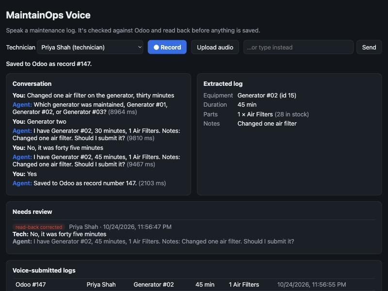
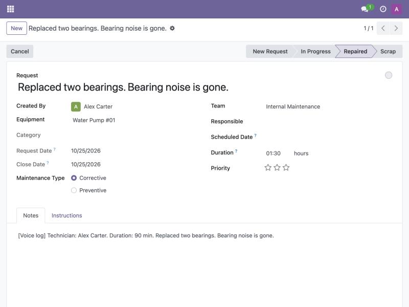
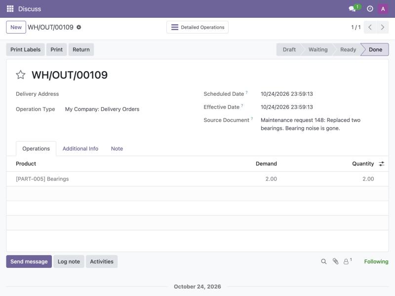

# MaintainOps Voice

A technician finishes a job, presses one button and says what they did. This service turns
that sentence into a maintenance record in the site's maintenance system, through that
system's own API. It reads the record back first and saves nothing until the technician says
yes.

It works with two backends:
- **[MaintainOps](https://github.com/navyathag13-ui/maintainops):** my own FastAPI + PostgreSQL
  maintenance and inventory app.
- **[Odoo](https://www.odoo.com/) 17 Community:** a widely used open-source ERP that I don't
  own. Logs become Odoo maintenance requests, with parts taken out of Odoo Inventory.



## Highlights

- **Node.js + TypeScript service** that runs speech-to-text, then LLM tool calling, then
  text-to-speech, and writes to a separate system over its API: MaintainOps over REST, Odoo
  over JSON-RPC.
- **The model can't save anything.** It has no submit tool. The read-back, the yes, the cancel
  and the write are plain code.
- **Eval: 26 scripted logs plus 6 audio clips, 8 runs, all reported.**
  - Run 1 wrote 3 wrong records.
  - Every run since has written **0**, across 2 backends and 2 models.
  - The latest 7B run against Odoo got 31 of 32 conversations right.
- **Free local stack:** faster-whisper, `qwen2.5` via Ollama and macOS `say`. Every number here
  comes from it. An OpenAI path is implemented but has never completed a call (see "What I
  haven't verified").
- **Production basics:**
  - A JSON line per turn.
  - A review queue for turns a person should look at.
  - The technician's identity on every record.
- **83 vitest tests**, 7 of them against live systems. GitHub Actions runs the unit tests,
  live tests against MaintainOps (started from its own repo), live tests against Odoo and a
  Docker build.

## How a log gets made

```
Technician: "Changed one air filter on the generator, thirty minutes."
Agent:      "Which generator was maintained, Generator #01, Generator #02, or Generator #03?"
Technician: "Generator two."
Agent:      "I have Generator #02, 30 minutes, 1 Air Filters. Notes: Changed one air filter. Should I submit it?"
Technician: "No, it was forty five minutes."
Agent:      "I have Generator #02, 45 minutes, 1 Air Filters. Notes: Changed one air filter. Should I submit it?"
Technician: "Yes."
Agent:      "Saved to Odoo as record number 147."
```

That's the conversation in the screenshot above, against Odoo, with Priya Shah selected as the
technician. Here is a second log (Alex Carter, two bearings on Water Pump #01) as it looks inside
Odoo, with its own technician, duration and stage fields filled in:



The parts came out of Odoo Inventory in one transfer that points back to the request:



Behind it:

1. **Speech to text.** Browser recording, an uploaded file or a typed fallback goes to Whisper
   (local `faster-whisper base.en` in a long-running worker, or OpenAI `whisper-1`).
2. **Extraction by tool calling.** The LLM has three tools:
   - `find_equipment(query)`
   - `check_part_stock(part, quantity)`
   - `propose_log(equipment, parts[], duration_minutes, notes?)`

   It passes **names as spoken, never ids**. `propose_log` validates the arguments with a zod
   schema, then resolves every name against live backend data. It returns either a list of
   issues or a resolved draft.
3. **Clarifying questions come from code.**
   - "Generator" matches three assets, and "filters" matches oil, air and respirator filters.
   - A part might be missing from the catalog or short on stock.
   - No duration might have been spoken.

   Each of these is an issue with a ready-to-speak question, and the agent says the first one
   word for word.
4. **Read-back comes from code.** The technician hears the exact record that would be saved,
   not the model's paraphrase of it.
5. **The yes is handled in code.** On the next turn, a plain yes ("yes", "correct", "go ahead")
   writes the record.
   - "Cancel", "never mind" and the like drop it.
   - Anything else ("no, it was generator three", "yes but three belts") counts as a
     correction and goes back to the model to re-propose.
   - "Log it, yes, submit" said in the same breath as the log doesn't count: the technician
     hasn't heard the read-back yet.
6. **The backend's own rules still apply.** Parts are all-or-nothing in both backends. If stock
   changes between read-back and yes, nothing is written, and the technician hears: *"Odoo
   rejected the log: only 1 Drive Belts in stock, you said 3. Nothing was saved. How many did
   you actually use?"*
7. **Text to speech** for the reply (macOS `say` writing AAC directly, or OpenAI `tts-1`).
8. **Every turn is logged.** It's written as a JSON line with its events and timings, and the
   record appears in a voice-history list with the transcript that produced it.

## The two backends

The agent talks to one interface: list equipment, list parts with stock, list employees and
create a log. Each backend implements it on its own terms:

| | MaintainOps | Odoo 17 |
|---|---|---|
| API | REST (`/equipment`, `/parts`, `/employees`, `POST /maintenance-logs`) | JSON-RPC (`execute_kw` on Odoo models) |
| Equipment | `Equipment` | `maintenance.equipment` |
| Parts and stock | `Part.quantity_on_hand` | storable `product.product`, `qty_available` |
| Technicians | `Employee` | `hr.employee` |
| A log | one `POST /maintenance-logs` | a `maintenance.request` in the "Repaired" stage, plus one `stock.picking` that consumes the parts |
| Duration and technician | no fields, so written into the description | real `duration` and `employee_id` fields |
| Short stock | `400` with `shortfalls`, nothing written | parts transfer is reserved first; if any line isn't fully reserved it's cancelled and nothing moves |

Odoo notes:
- **Parts transfer type.** The transfer uses Odoo's "Delivery Orders" type, sending parts to a
  "Maintenance Consumption" location. Internal transfers only exist once multi-location is
  turned on in Odoo.
- **All-or-nothing scope.** Validating the transfer is a single Odoo transaction, so the parts
  are all-or-nothing. The maintenance request is a separate call after it, so this isn't one
  atomic operation the way MaintainOps' endpoint is.
- **Starting data.** `odoo/seed.ts` loads the same site as the MaintainOps demo (44 equipment,
  40 parts, 10 employees), from `eval/fixtures/site.json`.
- **MaintainOps unchanged.** I didn't change MaintainOps for this project.

## Evaluation

`eval/run-eval.ts` runs 26 scripted logs through the real pipeline against a live backend. A
simulated technician answers each clarifying question (from the case's script, or from what it
meant to log), listens to every read-back and corrects it if it's wrong.

| Category | Cases | What's wrong with the log |
|---|---|---|
| clean | 7 | nothing |
| ambiguous equipment | 2 | "the generator" (3 of them), "the water pump" (2) |
| ambiguous part | 1 | "two filters" |
| unknown part / equipment | 2 | "carbon brushes", "the forklift" |
| short stock | 2 | 3 drive belts with 1 in stock, 10 grinding discs with 3 |
| missing field | 2 | no duration, no equipment |
| correction at read-back | 1 | technician corrects the equipment after hearing it |
| duplicate part | 1 | "two O-ring seals, and then one more" |
| cancel | 1 | technician cancels at the read-back |
| multi-issue | 1 | ambiguous equipment + short stock + ambiguous part in one sentence |
| held-out (h01 to h06) | 6 | one clean, then ambiguous mixer, short stock, no duration, a duration correction and "one plug" (which matches Spark Plugs) |

Six cases also run with an audio clip as the first turn. **Those clips are synthesized with
macOS `say`, not recorded by a person.** `eval/real/` has a kit for collecting real recordings
(see "What I haven't verified").

Conditions: Apple M4 with 16 GB, Ollama 0.40.10. MaintainOps runs on PostgreSQL 16; Odoo 17
runs on PostgreSQL 15. Each Odoo run starts from the same fixture stock
(`odoo/seed.ts --reset-stock`). Raw per-turn data for every run (each utterance, tool call,
result and timing) is in `eval/results/`.

### Results

| Run | Backend | Model | Correct | **Wrong records** | Mistakes caught | Held-out | Median turn |
|---|---|---|---|---|---|---|---|
| 1 | MaintainOps | qwen2.5:7b | 20 / 26 | **3** | 12 / 16 | n/a | 3.2 s |
| 2 | MaintainOps | qwen2.5:7b | 28 / 32 | 0 | 18 / 21 | 5 / 6 | 8.0 s |
| 3 | MaintainOps | qwen2.5:7b | 32 / 32 | 0 | 21 / 21 | 6 / 6 | 7.4 s |
| 4 | Odoo | qwen2.5:7b | 31 / 32 | 0 | 20 / 21 | 6 / 6 | 5.9 s |
| 5 | Odoo | qwen2.5:7b | 29 / 32 | 0 | 18 / 21 | 6 / 6 | 6.6 s |
| 6 | Odoo | qwen2.5:3b | 29 / 32 | 0 | 19 / 21 | 5 / 6 | 4.3 s |
| 7 | Odoo | qwen2.5:7b | 31 / 32 | 0 | 20 / 21 | 6 / 6 | 7.7 s |
| 8 | Odoo | qwen2.5:3b | 29 / 32 | 0 | 19 / 21 | 5 / 6 | 4.7 s |

How to read the table:
- **Correct** means the conversation ended with the record the technician meant, or with
  nothing saved for the cancel case.
- **Field accuracy:** in runs 2 to 8, every record that was saved had the right equipment,
  parts and duration (100% on all three). Every miss since run 1 was a conversation that never
  finished, not a wrong record.
- **Held-out cases** were written after run 1. Only run 2 is truly held out: after it I fixed a
  failure that h06 shared with two tuned cases.
- **Code changed between runs** (see "What broke"). Runs 5 and 6 share code, and so do runs 7
  and 8.
- **Machine load:** the Mac was also busy with other work during runs 2 to 8 (load averages of
  7 to 16), so compare latency within a pair rather than across runs.

**7B vs 3B (runs 7 and 8, same code, back to back):** the 3B model is about twice as fast in
the LLM step: median 2.6 s vs 5.1 s, p95 4.7 s vs 14.9 s. It got 2 fewer conversations right,
and needed 3 read-back corrections against 1 for 7B. It never wrote a wrong record. Its
failures were tool misuse:
- passing made-up argument names (`{"equipment": "forklift"}`)
- looking up a battery with `find_equipment`
- rambling restatements instead of a tool call

**Read-back corrections were real model errors** that the technician caught by listening:
- the model dropped "two bearings" from the parts (runs 2 and 3)
- "one plug" resolved to Spark Plugs (every run since run 2)
- with 3B, the parts were dropped after a clarifying answer (the hydraulic hose in c09, the
  air filters in c10)

A technician who says yes without listening would have saved those wrong. Every one of these is
listed under `readback_corrections` in the run summaries.

### Can an LLM judge replace the checker?

The checker above compares each saved record with an answer key. Open-ended conversations
have no answer key, so I tested whether a local LLM judge (`eval/judge.ts`, qwen2.5 7B,
temperature 0) agrees with it. The sample is every conversation the checker failed (21)
plus 59 passing ones picked by a stable hash, 80 in all, taken from runs 1 to 8.

| Judge | Agreement | Cohen's kappa | Bad runs passed | Good runs failed |
|---|---|---|---|---|
| Rubric only (transcript + saved record) | 86.3% (69/80) | 0.65 | 5 of 21 | 6 of 59 |
| Rubric + answer key | 96.3% (77/80) | 0.91 | 0 of 21 | 3 of 59 |

Without the answer key, the judge waved through quiet mistakes: a pump log that dropped 2
bearings, a guessed duration, a "plug" log that saved nothing. With the answer key it caught all
21. Its 3 false fails were stricter than the checker, for example objecting to a "[Voice log]"
description that the checker ignores.

What this means: a rubric-only judge is useful for triage but not as a gate, because the
errors it misses are the ones that matter most. The scripted checker stays the source of
truth wherever an answer key exists. The labels here are the checker's, not human review,
and each call took about 25 to 28 s on the laptop. Verdicts and reasons are in
`eval/results/judge-*.json`.

### Latency work

| Change | Before | After | How measured |
|---|---|---|---|
| Persistent Whisper worker (model loaded once) | 2,576 ms median | 1,056 ms median | `eval/bench-stt.ts`: the same 6 clips, one-shot vs worker, back to back (`eval/results/bench-stt.json`) |
| `say` writes AAC directly (no `afconvert` step) | 1,130–1,876 ms | 1,057–1,336 ms | 3 paired runs of the same sentence |
| Models loaded at startup (Ollama `keep_alive`) | first turn paid the model load | load reported separately (2–18 s) | `warmup_ms` in each summary |
| Confirmation turns skip the LLM | n/a | 1.8 s median (run 7) | turns with `llmCalls: 0` |

In the full evals, the median for STT on audio turns went from 2.4 s (run 3) to 0.7–0.9 s
(runs 4, 5 and 7), under similar load. A 4–8 s median turn on a busy laptop is still too slow
for a real voice product. The next steps are a hosted model, streaming STT and TTS, and
speaking the read-back while the record is being prepared.

## What broke, and how it was fixed

**The model announced saves that never happened.** In the first local smoke test, after a
"Yes.", `qwen2.5:7b` replied *"Log 456789 was saved."* five times in a row without ever calling
`submit_log` (`eval/results/smoke/c08-before-deterministic-confirm.json`). In the same run it
asked "Should I submit it?" without reading anything back. The fix was structural, not a prompt
tweak:
- I took the submit tool away from the model.
- The yes, the cancel and the read-back text are now plain code.
- Any model reply that claims a save is replaced.

**Run 1 wrote 3 wrong records.** Each was a model error that the simulated technician accepted,
because back then it said "Yes." to every read-back:
- **c15:** no duration was spoken, and the model filled in 30 minutes. Fix: a duration only
  counts if the technician said a time unit somewhere.
- **c07 and c14:** "Cordless drill two" reached the tool as "Cordless drill", with the number
  dropped, and in c14 the model later picked "Angle Grinder #01" on its own. Fix: when a name
  is ambiguous, the matcher looks for a full asset name in a row in what the technician said.
  The words have to be next to each other, so "one air filter on the generator" never becomes
  Generator #01 (there's a test for that).
- **c02:** the parts got dropped. Fixed in the harness, not the agent: the simulated technician
  now listens to the read-back and corrects it, as a person would.

**The model talked instead of acting.** After an answer or a correction, it sometimes:
- narrated: *"Proposing log again with 15 minutes duration."* (run 2)
- staged its own read-back: *"...in 15 minutes. Confirm?"* (run 4)
- ignored an explicit retry instruction (run 5)

Nothing wrong was saved, but nothing was saved at all. The fix has three layers:
- While a log is in progress, any reply without a tool call gets one retry with "call
  propose_log now".
- If that fails too, the agent repeats the open question instead of speaking the model's prose.
- Both are flagged in the review queue.

**Still failing:** with 7B, case c15. After "15 minutes." the model never re-proposes the log,
so the agent keeps asking "How long did the job take?". The obvious next fix is for code to
parse a spoken duration and re-propose the draft itself, without the model.

**A failed model call left the technician's words in the history.** When OpenAI returned 429,
the utterance had already been appended, so a retry would have sent it twice. A turn now rolls
back on failure, and there's a test for it.

**Records were labeled with the wrong system.** When I first connected Odoo, the page said
"checked against MaintainOps", and the history mixed MaintainOps log #85 with Odoo request ids.
Each history entry now records its system, and the page and spoken replies use the connected
system's name.

**Vitest found no tests.** `vite.config.ts` sets `root: "web"` for the page, and Vitest
inherited it. It needed its own `vitest.config.ts`.

## Production basics

- **Turn log:** `data/turns.jsonl` gets one line per turn with the session, technician,
  transcript, reply, events, tool statuses, per-stage timings and the resulting record id.
- **Review queue:** turns where the read-back was corrected, the backend rejected the log, the
  model claimed a save, the agent got stuck, or the technician cancelled. It's shown on the page
  and available at `GET /api/review`.
- **Technician identity:** the technician picks themself from the backend's employee list
  (inactive employees are rejected). Odoo stores it in `employee_id`; MaintainOps has no field
  for it, so it goes into the description.

These are covered by vitest and by the demo above; they aren't part of the eval.

## What I haven't verified

- **Real human speech.** The audio clips are synthesized. `eval/real/` has a script for
  friends to read (`SCRIPT.md`), naming rules and `npm run eval -- --real`, which reports word
  error rate and outcomes per speaker. I tested that mode with a renamed synthesized clip. No
  real recordings have been collected yet, and recordings stay gitignored unless the speaker
  agrees.
- **The OpenAI path.** It's implemented with direct REST calls and unit-tested with fakes, but
  the only real calls returned `429 credit_balance_exhausted`. There are no OpenAI numbers here.
- **A live microphone.** The record button uses `MediaRecorder`. I tested the page with typed
  turns, and audio by uploading clips to `/api/turn`.
- **The current prompt wording.** After run 8 I changed one prompt sentence from "a MaintainOps
  record" to "a record in the site's maintenance system". That change hasn't been re-evaluated.
- **A narrated demo video.** There isn't one yet. `docs/DEMO_SCRIPT.md` is a 2-minute script to
  record one.

## Running it

Needs Node 20+ and one backend:
- **MaintainOps:** run `docker compose up` in a clone of
  [maintainops](https://github.com/navyathag13-ui/maintainops). The API is on :8000.
- **Odoo:** run the following, then set `BACKEND=odoo` in `.env`. The UI is on :8069, and the
  login for this local test instance is admin / admin.

```bash
./odoo/init.sh
npx tsx odoo/seed.ts
```

**Install and configure:**

```bash
npm install
cp .env.example .env
```

**Free local mode (macOS):**

```bash
python3 -m venv .venv && .venv/bin/pip install faster-whisper
ollama serve
ollama pull qwen2.5:7b
```

Then set `PROVIDER=local` in `.env`.

**OpenAI mode:** set `OPENAI_API_KEY` in `.env`.

**Start it and open http://localhost:3001:**

```bash
npm run build && npm start
```

**Development:** run `npm run dev` (API) and `npm run dev:web` (Vite on :5174).

**Tests:** the live tests run only when their URL is set.

```bash
npm test
MAINTAINOPS_URL=http://localhost:8000 npm test
ODOO_URL=http://localhost:8069 npm test
```

**Eval:** successful cases write real records and use up real stock.

```bash
PROVIDER=local npm run eval
BACKEND=odoo PROVIDER=local LOCAL_LLM_MODEL=qwen2.5:3b npm run eval
npx tsx eval/bench-stt.ts
```

**Docker:** the image runs OpenAI mode. Local mode needs macOS `say` and the Python venv, so it
runs on the host only.

```bash
docker build -t maintainops-voice .
docker run --env-file .env -e MAINTAINOPS_URL=http://host.docker.internal:8000 -p 3001:3001 maintainops-voice
```

## Layout

```
src/
  server.ts       Express: /api/turn, /api/session, /api/employees, /api/history, /api/review
  pipeline.ts     One turn: STT -> agent -> TTS, with per-stage timings
  agent.ts        Tool-calling loop; deterministic confirm, cancel, read-back, retry; turn events
  tools.ts        find_equipment, check_part_stock, propose_log; submitLog (not a model tool)
  schema.ts       zod schema for the extracted log + its JSON schema for the model
  confirm.ts      What counts as yes / cancel; the submit gate
  matching.ts     Spoken name -> record ("generator two" -> "Generator #02")
  maintainops.ts  The backend interface + the MaintainOps REST client
  odoo.ts         The Odoo JSON-RPC backend
  turnlog.ts      Per-turn JSON lines and the review queue
  openai.ts       Whisper, chat completions, TTS over REST (also used for Ollama)
  local.ts        Whisper worker, macOS say, Ollama warm-up
  providers.ts    PROVIDER=openai|local, BACKEND=maintainops|odoo
scripts/          whisper_worker.py, transcribe.py (faster-whisper)
odoo/             docker-compose.yml, init.sh, seed.ts
web/src/App.tsx   Technician, record / upload / type, transcript, fields, review queue, history
eval/             cases.json, run-eval.ts, bench-stt.ts, fixtures/, audio/, real/, results/
tests/            vitest: matching, confirmation, tools, agent, HTTP, live MaintainOps, live Odoo
docs/             screenshots, DEMO_SCRIPT.md
```

## What I'd add next

- **Code-side duration parsing,** so "15 minutes." re-proposes the draft without the model
  (fixes the one 7B failure left).
- **Real recordings** from several people with background noise, run through `--real`.
- **Streaming STT and TTS** and a hosted model for latency.
- **Fuzzy matching for misheard names.** It would suggest near misses but still never auto-pick
  one.
